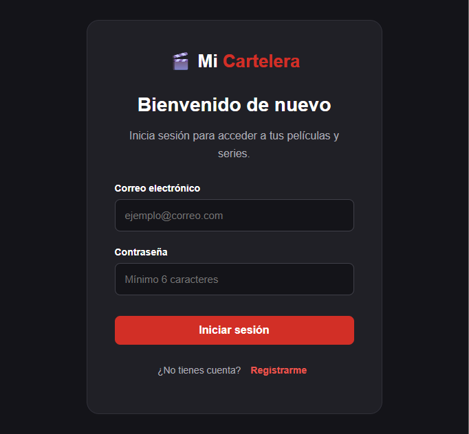
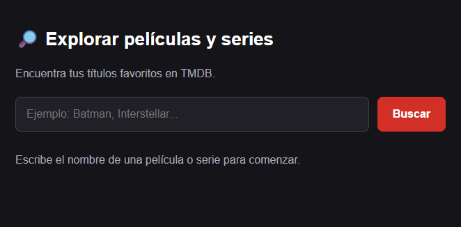
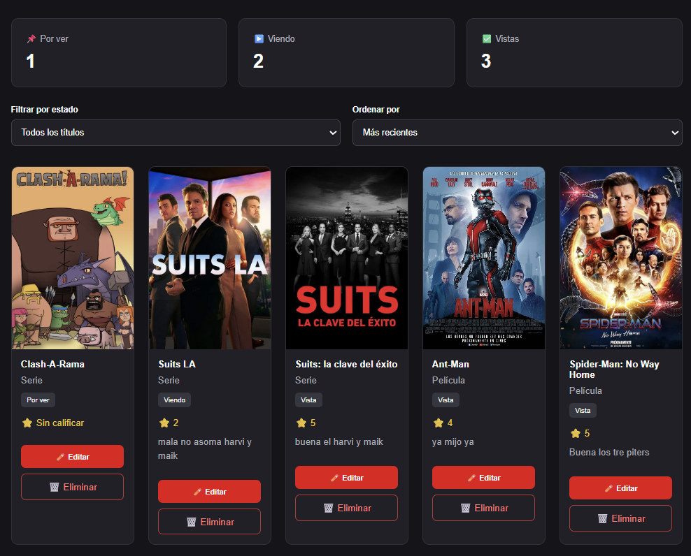
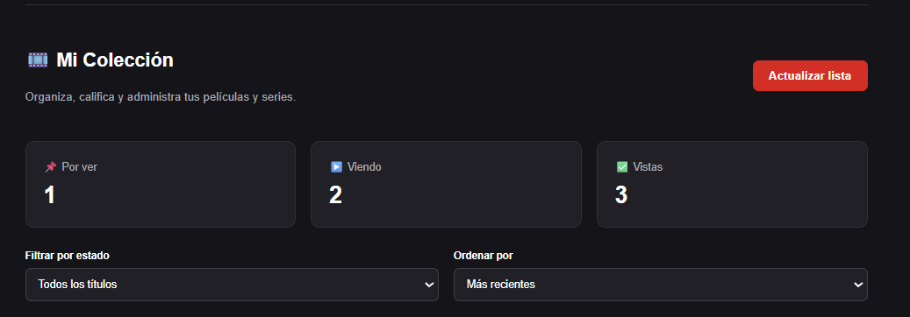

# 🎬 Mi Cartelera Personal

Aplicación web desarrollada con React, TypeScript y Vite que permite buscar películas y series, crear una colección personal y llevar un registro de los títulos vistos o pendientes.

## Descripción

Mi Cartelera Personal es un proyecto que integra una API externa (TMDB), autenticación de usuarios mediante Supabase Auth y almacenamiento de datos en PostgreSQL.

Cada usuario puede administrar una colección privada de películas y series, registrando estados de visualización, calificaciones y comentarios personales.

## Tecnologías utilizadas

- **React:** desarrollo de componentes e interfaz.
- **TypeScript:** tipado de datos y componentes.
- **Vite:** entorno de desarrollo y compilación.
- **TMDB API:** búsqueda e información de películas y series.
- **Supabase Auth:** registro, inicio y cierre de sesión.
- **Supabase PostgreSQL:** almacenamiento de la colección personal.
- **Row Level Security (RLS):** control de acceso a los registros por usuario.

## Funcionalidades

- Registro e inicio de sesión.
- Protección del contenido para usuarios autenticados.
- Búsqueda de películas y series mediante TMDB.
- Visualización de pósters, títulos y años de estreno.
- Almacenamiento de títulos en una colección personal.
- Edición de estados: Por ver, Viendo y Vista.
- Calificación personal del 1 al 5.
- Comentarios personales.
- Eliminación de títulos.
- Página ampliada con sinopsis, géneros y elenco.
- Filtros por estado.
- Ordenamiento por fecha o calificación.
- Contadores de títulos según el estado.

## Requisitos de instalación

- Node.js compatible con Vite.
- npm.
- Proyecto de Supabase configurado.
- Clave de acceso a la API de TMDB.

## Instalación

Clonar el repositorio:

```bash
git clone https://github.com/carlitosusfq/mi-cartelera-personal.git
```

Entrar a la carpeta:

```bash
cd mi-cartelera-personal
```

Instalar dependencias:

```bash
npm install
```

## Variables de entorno

Crear un archivo llamado `.env.local` en la raíz del proyecto, con las siguientes variables:

```dotenv
VITE_SUPABASE_URL=TU_URL_DE_SUPABASE
VITE_SUPABASE_PUBLISHABLE_KEY=TU_CLAVE_PUBLICA_DE_SUPABASE
VITE_TMDB_API_KEY=TU_API_KEY_V3_DE_TMDB
```

Reemplazar los valores de ejemplo por las credenciales correspondientes.

La tabla `mi_lista` debe estar creada en Supabase con las políticas RLS necesarias.

No subir contraseñas, claves privadas ni tokens sensibles al repositorio.

## Ejecución

Iniciar el servidor de desarrollo:

```bash
npm run dev
```

Abrir la dirección local indicada por Vite, generalmente:

`http://localhost:5173/`

Para generar una versión de producción:

```bash
npm run build
```

## Seguridad

La aplicación utiliza Supabase Auth para administrar las sesiones y PostgreSQL con políticas RLS para restringir el acceso a la colección personal de cada usuario.

## Capturas de pantalla

### Inicio de sesión


### Buscador


### Mi Colección


### Detalles


Para este producto se llegó a utilizar la API de TMDB gratuita para desarrolladores con fines académicos.